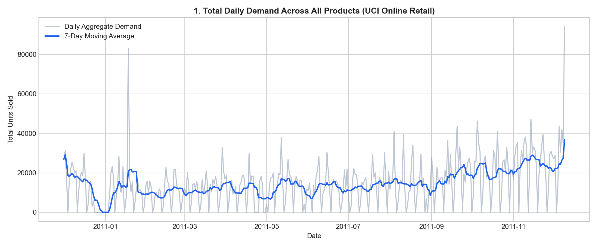
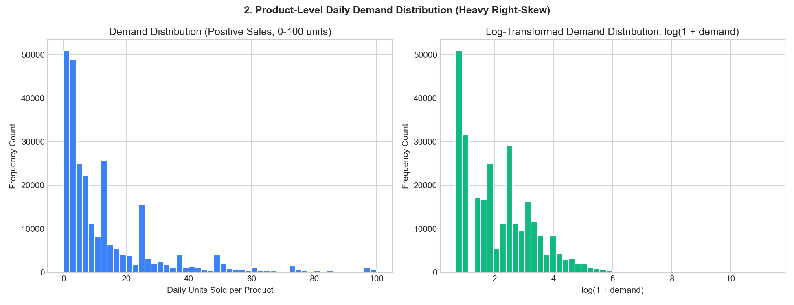
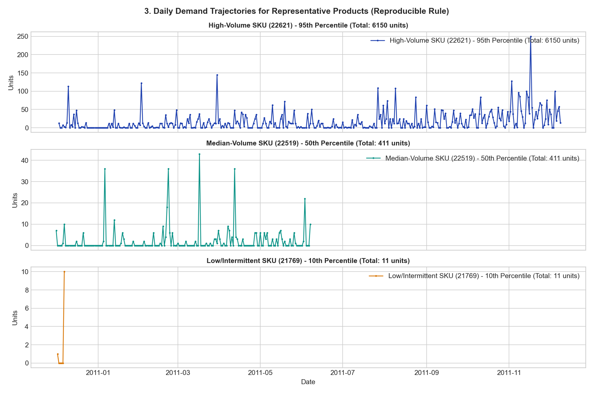
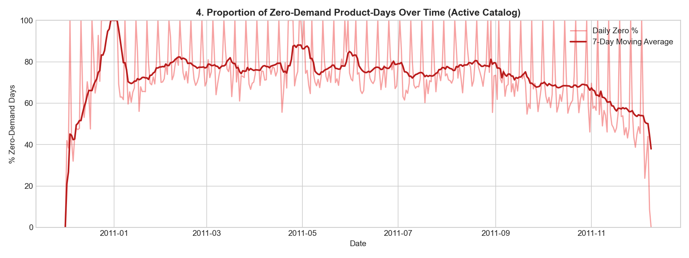
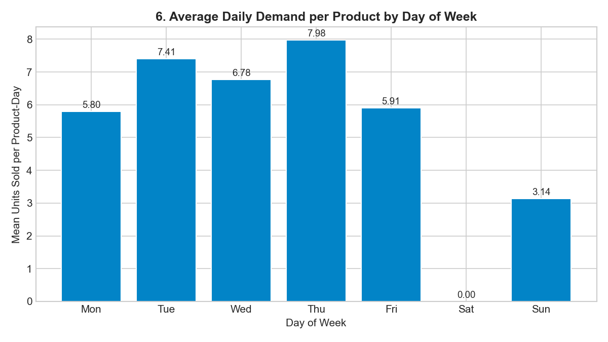

# Retail Sales Forecasting and Inventory Optimization System

A production-grade retail demand forecasting and inventory optimization decision-support platform built with Python, Scikit-Learn, Pandas, NumPy, and Streamlit.

## Executive Summary

Inventory management in enterprise retail requires balancing two competing operational risks: holding excess inventory, which inflates working capital and storage costs, and holding insufficient inventory, which causes stockouts, lost revenue, and customer dissatisfaction. 

This platform bridges predictive machine learning demand forecasting with prescriptive inventory replenishment decision-making. The system processes multi-year historical retail transactions, aggregates leak-free daily product demand series, trains autoregressive supervised learning models against statistical baselines, and computes mathematically rigorous periodic review (R, s, S) replenishment policies.

The platform provides complete dual-dataset support:
1. United Kingdom E-Commerce Retail (UCI Online Retail dataset): 2,813 catalog products, 68,907 out-of-sample backtest observations, 28-day evaluation window.
2. Global Multi-Channel Supply Chain (DataCo Smart Supply Chain dataset): 118 catalog products, 1,127 calendar days coverage (2015-01-01 to 2018-01-31), 367,591 physical units of gross placed demand, 8-day fixed-origin recursive inventory horizon.

Both datasets are strictly isolated within the architecture: switching datasets in the dashboard dynamically reconfigures data loaders, metrics, charts, forecasting scorecards, product explorers, and inventory replenishment recommendations without cross-dataset data bleeding.

---

## Key Capabilities and Highlights

* Dual-Dataset Isolation: Complete separation between UK e-commerce transactions and global supply chain data.
* Leak-Free Feature Store: Autoregressive lags, rolling statistics, and calendar features constructed with strict temporal boundaries to prevent future data leakage.
* Benchmark Model Evaluation: Out-of-sample comparison of 7-day Seasonal Naive and 7-day Rolling Mean baselines against an Autoregressive Random Forest Regressor evaluated on identical test observations using Mean Absolute Error (MAE), Root Mean Squared Error (RMSE), and Weighted Absolute Percentage Error (WAPE).
* Multi-Step Recursive Forecasting: Autoregressive forward simulation over multi-day protection periods without accessing future ground-truth demand.
* Dynamic Inventory Sizing: Calculation of Lead Time Demand (LTD), Protection Period Demand (PPD), dynamic Safety Stock (SS) parameterized by target Cycle Service Level (CSL) z-scores, Reorder Points (ROP), and order-up-to Target Stock Levels (S).
* Actionable Procurement Generation: Automatic creation of purchase orders and downloadable CSV replenishment orders for products whose net inventory position falls to or below the reorder point.
* Interactive Streamlit Dashboard: Multi-page web application featuring executive KPI cards, daily demand trends, forecast scorecards, SKU deep dives, simulation planning, and non-PII product catalog explorers.
* Production Test Coverage: 217 automated unit and integration tests passing across data validation, feature engineering, baseline forecasting, machine learning, inventory logic, and Streamlit AppTest UI navigation.
* Privacy by Design: Zero customer Personally Identifiable Information (PII) is processed, displayed, or logged.

---

## Dataset Architecture and Scope

The system supports two independent real-world retail transaction repositories.

| Dimension | UCI Online Retail Pipeline | DataCo Smart Supply Chain Pipeline |
| :--- | :--- | :--- |
| Business Domain | UK-based online giftware and homeware wholesaler | US and Latin American multi-channel supply chain |
| Primary Transaction Range | 2010-12-01 to 2011-12-09 (374 calendar days) | 2015-01-01 to 2018-01-31 (1,127 calendar days) |
| Transaction Volume | 541,909 raw transaction lines | 180,519 raw order-lines across 65,752 orders |
| Product Catalog Size | 2,813 distinct products with active demand | 118 catalog products (Core 9 cohort analyzed) |
| Target Demand Definition | Daily net quantity placed on positive orders | Gross placed retail demand (excluding canceled/fraud) |
| Total Recorded Demand | 808,610 demand units | 367,591 physical demand units |
| Forecast Benchmark Window | 28 calendar days (2011-11-12 to 2011-12-09) | 32 calendar days (2017-09-01 to 2017-10-02) |
| Evaluated Observations | 68,907 identical product-date test records | 288 identical product-date test records |
| Inventory Decision Origin | 2011-11-11 (28-day forward evaluation) | 2017-08-31 (8-day forward protection window) |
| Supply Chain Policy | Periodic review (R=1 day, L=7 days, CSL=95%) | Periodic review (R=1 day, L=7 days, CSL=95%) |

---

## System Architecture

The project follows a modular, decoupled architecture organized into distinct functional layers:

```text
Retail-Sales-Forecasting-Inventory-Optimization/
├── app/                              # Interactive Streamlit application
│   ├── components.py                 # Reusable UI widgets and KPI metric cards
│   ├── data_loader.py                # Cached data access layer for UCI and DataCo
│   ├── scenario_engine.py            # What-if simulation and sensitivity analysis engine
│   ├── streamlit_app.py              # Main dashboard entry-point and routing
│   └── views/                        # Page views for UCI and DataCo workflows
├── config/                           # YAML configuration files for pipelines
├── data/                             # Data directory structure
│   ├── raw/                          # Raw transaction files (excluded from Git)
│   ├── interim/                      # Cleaned transaction parquet stores
│   └── processed/                    # Processed daily demand series and catalogs
├── docs/                             # Technical documentation and audit specifications
├── images/                           # Visual charts, plots, and workflow previews
├── models/                           # Trained model checkpoints
├── notebooks/                        # Exploratory data analysis and feature prototyping
├── outputs/                          # Generated forecast comparisons, metrics, and orders
│   ├── dataco/                       # DataCo forecasts, metrics, and recommendations
│   ├── figures/                      # Exploratory data analysis charts
│   ├── forecasts/                    # UCI forecast comparison parquet tables
│   ├── inventory/                    # UCI inventory recommendations and purchase orders
│   └── metrics/                      # Model accuracy JSON summaries
├── scripts/                          # Standalone CLI entry-point scripts
├── src/                              # Core Python package (retail_forecasting)
│   ├── data/                         # Ingestion, validation, and preprocessing
│   ├── features/                     # Leak-free time-series feature engineering
│   ├── forecasting/                  # Baseline and ML models, training, evaluation
│   ├── inventory/                    # Safety stock, ROP, Target Stock, and EOQ sizing
│   ├── utils/                        # Logging, seed management, and path helpers
│   └── visualization/                # Matplotlib and Plotly charting routines
└── tests/                            # Automated test suite (unit and integration)
```

---

## Methodological Framework and Mathematical Formulations

### 1. Demand Definition and Filtering

* Gross Placed Demand Policy: Daily demand represents units placed by customers on order creation dates, excluding order cancellation and suspected fraud records.
* Non-Negative Demand Constraint: Retail customer demand cannot be negative. All model predictions are bounded at zero: predicted demand = max(0, prediction).
* Lifespan Zero-Filling: Continuous calendar grids are constructed per product from its first recorded sale date to the dataset cutoff date. Days with zero recorded transactions are explicitly represented as zero demand rather than dropped.

### 2. Time-Series Feature Engineering

Features are constructed with strict temporal causality to ensure zero future data leakage:
* Lag Features: Historical demand at lag intervals t-1, t-2, t-3, t-7, t-14, t-21, and t-28 days.
* Rolling Summary Statistics: Moving averages and standard deviations computed over 7-day, 14-day, and 28-day windows. All rolling calculations strictly exclude the target day t by shifting by 1 day.
* Calendar Indicators: Day of the week, day of the month, month of the year, and binary weekend indicators.

### 3. Forecast Evaluation Metrics

Forecast accuracy is quantified using three standard supply chain metrics:

1. Mean Absolute Error (MAE):
   Measures average absolute error in physical units:
   MAE = (1 / N) * sum(|y_i - y_hat_i|)

2. Root Mean Squared Error (RMSE):
   Penalizes large errors more heavily:
   RMSE = sqrt((1 / N) * sum((y_i - y_hat_i)^2))

3. Weighted Absolute Percentage Error (WAPE):
   Scale-independent portfolio accuracy metric:
   WAPE = sum(|y_i - y_hat_i|) / sum(y_i)

### 4. Inventory Optimization Formulation

The inventory engine implements a periodic review (R, s, S) replenishment policy under stochastic demand and deterministic supplier lead time:

* Review Period (R): Fixed interval between review checks (default: 1 calendar day).
* Supplier Lead Time (L): Elapsed days between order placement and receipt into available stock (default: 7 calendar days).
* Protection Period (P): Exposure window during which stockout risk exists: P = L + R (default: 8 calendar days).
* Lead Time Demand (LTD): Cumulative expected demand over supplier lead time:
  LTD = sum_{t=1}^L (y_hat_t)
* Protection Period Demand (PPD): Cumulative expected demand over the protection window:
  PPD = sum_{t=1}^{L+R} (y_hat_t)
* Safety Stock (SS): Buffer stock absorbing demand volatility over lead time:
  SS = z * sigma_e * sqrt(L)
  where z is the standard normal score corresponding to the target Cycle Service Level (z = 1.6449 for 95% CSL), and sigma_e is the daily out-of-sample forecast error standard deviation.
* Reorder Point (ROP): Threshold triggering replenishment:
  ROP = LTD + SS
* Target Stock Level (S): Order-up-to stocking level covering protection period demand and buffer:
  S = PPD + (z * sigma_e * sqrt(L + R))
* Net Inventory Position (IP): Effective current inventory state:
  IP = On_Hand + On_Order - Backorders
* Replenishment Order Quantity (Q):
  If IP <= ROP, then Q = max(0, ceil(S - IP)); otherwise, Q = 0.
* Economic Order Quantity (EOQ) Benchmark:
  EOQ = sqrt((2 * D * S_order) / H)
  where D is annualized demand, S_order is fixed ordering cost, and H is annual holding cost per unit.

---

## Methodological Safeguards and Operational Disclaimers

1. Rolling 1-Day Benchmark vs Fixed-Origin Multi-Step Forecasting:
   * Rolling benchmark models predict day t using actual observed history through day t-1 across the test period.
   * Inventory optimization requires multi-step recursive forecasting strictly from the decision origin date without observing intermediate future demand.
2. Demand Definition vs Fulfilled Sales:
   * Historical transaction records document placed customer orders. They do not record stockout duration, unfulfilled customer demand, lost sales, or true warehouse inventory levels.
3. Simulated Operational Inventory Parameters:
   * Initial on-hand inventory, in-transit purchase orders, backorders, supplier lead times, holding costs, and review cycles are simulated operational demonstration inputs. They must not be interpreted as live commercial procurement records.

---

## Visual Previews and Analytics

The platform includes analytical charts illustrating historical patterns, demand distributions, and forecasting outputs located in the `images/` directory:

### Total Daily Demand Over Time
Portfolio-level historical sales volume tracking seasonality and calendar patterns.


### Product Demand Distribution and Skewness
Demonstration of high skewness and intermittency in retail transaction data.


### Representative Product Profiles
Demand profiles across high-volume, median, and low-volume catalog items.


### Zero-Demand Proportion
Proportion of catalog items recording zero sales on any given day, demonstrating intermittency.


### Day of Week Seasonality
Demand distribution grouped by day of the week, illustrating retail purchasing cycles.


---

## Installation and Local Setup

### Prerequisites
* Python 3.10 or higher
* Git command line client
* Standard virtual environment tooling (`venv` or `conda`)

### 1. Clone the Repository
```bash
git clone https://github.com/your-username/retail-sales-forecasting-inventory-optimization.git
cd retail-sales-forecasting-inventory-optimization
```

### 2. Configure Virtual Environment
```bash
# Windows
python -m venv .venv
.venv\Scripts\activate

# Linux / macOS
python3 -m venv .venv
source .venv/bin/activate
```

### 3. Install Dependencies
```bash
pip install --upgrade pip
pip install -r requirements.txt
```

### 4. Configure Environment Variables
Copy the template configuration file:
```bash
# Windows
copy .env.example .env

# Linux / macOS
cp .env.example .env
```
The application executes locally without external third-party API keys or cloud services.

---

## Running the Execution Pipelines

The repository contains separate, reproducible command line scripts for both datasets:

### UCI Online Retail Pipeline
```bash
# 1. Clean transactions and build daily product demand series
python scripts/prepare_data.py --config config/config.yaml

# 2. Train Random Forest model and execute 28-day chronological evaluation
python scripts/train_model.py --config config/config.yaml

# 3. Generate inventory replenishment recommendations and purchase orders
python scripts/generate_recommendations.py --config config/config.yaml
```

### DataCo Smart Supply Chain Pipeline
```bash
# 1. Preprocess raw transactions into daily demand series and product catalog
python scripts/preprocess_dataco.py

# 2. Run 9-product forecasting benchmark and fixed-origin recursive forecasts
python scripts/benchmark_dataco.py

# 3. Generate DataCo inventory optimization recommendations and purchase orders
python scripts/generate_dataco_recommendations.py
```

---

## Launching the Interactive Streamlit Dashboard

To start the interactive web application locally:

```bash
streamlit run app/streamlit_app.py
```

The application will launch in your default web browser at:
`http://localhost:8501`

### Dashboard Navigation:
* Dataset Selector: Located in the sidebar. Allows switching between **UCI Online Retail** and **DataCo Smart Supply Chain**.
* UCI Online Retail Views:
  1. Executive Overview: High-level KPIs, project introduction, and pipeline architecture.
  2. Sales Analytics: Historical portfolio trends, date range filters, and top-product rankings.
  3. Forecast Model Comparison: Model error scorecard (MAE, RMSE, WAPE), metric definitions, and actual vs forecast visualizer.
  4. SKU Deep Dive and Explorer: Single-product historical time-series inspector with zero-demand preservation.
  5. Inventory Optimization and ROP: Recommendations table, safety stock calculations, and replenishment purchase orders CSV export.
  6. Simulation and What-If Planning: Interactive policy simulator allowing users to adjust service level, supplier lead time, and stock positions.
* DataCo Smart Supply Chain Views:
  1. Overview: Portfolio KPIs, Core 9 benchmark summary, gross demand guardrails, and simulated inventory banners.
  2. Sales Analytics: 1,127-day daily demand trends, date filtering, department breakdowns, and top products.
  3. Forecast Performance: Benchmark comparison across Seasonal Naive, Rolling Mean, and Random Forest models on identical test records.
  4. Product Catalog and Explorer: 118-product catalog with search, department filtering, and zero customer PII.
  5. Inventory Optimization: Fixed-origin 8-day recursive forecast horizon chart, recommendations table, and purchase orders CSV export.

---

## Automated Testing and Verification

The repository includes a comprehensive test suite built with `pytest` and `streamlit.testing.v1.AppTest`:

```bash
# Run the complete test suite
pytest

# Run tests with verbose output
pytest -v

# Run only dashboard tests
pytest tests/test_dashboard.py tests/test_dataco_dashboard.py -v

# Run only scenario analysis tests
pytest tests/test_scenario_analysis.py -v
```

Current Test Status:
* 217 passed, 1 skipped (optional openpyxl environment check), 0 failed.
* Tests validate data validation integrity, leak-free feature engineering, baseline forecasting, random forest regression, periodic review inventory logic, and end-to-end Streamlit UI rendering.

---

## Data Privacy and Security Standards

* Zero Customer PII: All customer names, email addresses, phone numbers, street addresses, postal codes, and customer IDs are excluded from processed data stores and dashboard interfaces.
* Local Execution: The entire codebase, machine learning training, and web dashboard execute on the local host without outbound network requests or external tracking.
* Security Scanning: Zero hardcoded API keys, tokens, or credentials are present in the repository.

---

## Documentation Index

Detailed engineering documentation is available in the `docs/` folder:

* `docs/project_architecture.md`: Module topologies, data contracts, and design patterns.
* `docs/data_dictionary.md`: Column specifications, types, and mathematical formulas.
* `docs/methodology.md`: Mathematical proofs and learning mechanisms.
* `docs/assumptions_and_limitations.md`: Operational boundaries and design constraints.
* `docs/dataco_provenance.md`: DataCo source provenance, Mendeley Data repository details, and CC-BY 4.0 license.
* `docs/dataco_preprocessing_report.md`: DataCo cleaning, status inclusion audit, and daily aggregation.
* `docs/dataco_forecasting_benchmark.md`: Core 9 benchmark models, metrics, and evaluation protocols.
* `docs/dataco_inventory_optimization.md`: Fixed-origin multi-step forecasting and uncertainty estimation.
* `docs/dataco_dashboard.md`: Phase 10 dashboard integration, dataset selector, and navigation guide.

---

## License and Attribution

This project is licensed under the MIT License. See the `LICENSE` file for details.

The project utilizes two public research datasets:
1. UCI Machine Learning Repository Online Retail Dataset (CC BY 4.0 license):
   Daqing Chen, Sai Liang Sain, and Kun Guo, Data mining for the online retail industry: A case study of RFM model-based customer segmentation using data mining, Journal of Database Marketing and Customer Strategy Management, Vol. 19, No. 3, pp. 197-208, 2012.
2. DataCo Smart Supply Chain Dataset (CC BY 4.0 license):
   Constante, Fabian; Silva, Fernando; Pereira, António (2019), DataCo SMART SUPPLY CHAIN FOR BIG DATA ANALYSIS, Mendeley Data, V1, doi: 10.17632/8gwmn42f3f.1.
