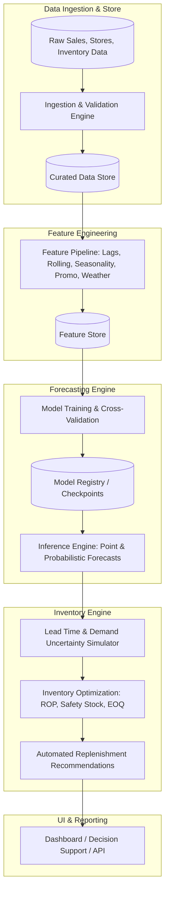

# System Architecture & Modular Design

## 1. Overview
The **Retail Sales Forecasting & Inventory Optimization System** is designed to bridge predictive analytics (time-series sales demand forecasting) with prescriptive operational decisions (inventory replenishment, safety stock calculations, and supply chain cost minimization).

---

## 2. Core Modules Breakdown

### Module 1: Ingestion & Validation (`src/data/`)
- **Responsibilities**:
  - Load raw transactional records, inventory ledgers, catalog metadata, and calendar/promotional events.
  - Data schema validation, null detection, out-of-range checks, and timestamp consistency verification.

### Module 2: Feature Engineering & Preprocessing (`src/features/`)
- **Responsibilities**:
  - Time-series frequency harmonization (daily/weekly aggregation).
  - Temporal feature extraction (day of week, month, holidays, promotional flags).
  - Autoregressive features: Lagged sales ($t-1, t-7, t-14, t-28$), rolling statistics (mean, std, min, max, exponentially weighted averages).
  - Cross-sectional grouping (Store-SKU hierarchical levels).

### Module 3: Forecasting Engine (`src/models/`)
- **Responsibilities**:
  - Baseline models (Naive, Moving Average, Exponential Smoothing / Holt-Winters).
  - Machine Learning & Gradient Boosting (LightGBM, XGBoost, CatBoost).
  - Deep Learning / Probabilistic models for uncertainty estimation (e.g., DeepAR / TFT or Quantile Regression).
  - Backtesting and rolling-window time-series cross validation (preventing data leakage).

### Module 4: Inventory Optimization Engine (`src/inventory/`)
- **Responsibilities**:
  - Service Level target mapping ($Z$-score / cycle service level $CSL$).
  - Dynamic Safety Stock ($SS$) under demand and lead-time variability.
  - Reorder Point ($ROP$) calculation: $ROP = (\mu_D \times L) + SS$.
  - Economic Order Quantity ($EOQ$) with holding costs vs. ordering costs constraints.
  - Multi-echelon or single-echelon replenishment scheduling.

### Module 5: API & Reporting (`src/api/` & `src/dashboard/`)
- **Responsibilities**:
  - Serve forecast outputs, confidence intervals, and recommended purchase orders.
  - Evaluation reports, drift detection metrics, and simulation logs.

---

## 3. Communication & Interface Contracts
- **Data Exchange**: Parquet / SQLite / DuckDB / Pandas DataFrames with strict type contracts.
- **Config Management**: Centralized YAML/JSON configuration files for reproducibility across data pipelines and hyperparameter tuning.
