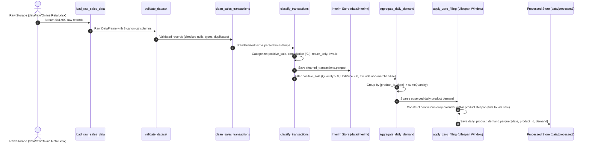

# Data Pipeline & Flow Architecture

## 1. End-to-End Data Lifecycle

The pipeline transforms raw line-item retail transaction logs into daily product-level demand series ready for forecasting feature engineering and inventory simulation.

---

## 2. Preprocessing & Quality Controls

### Transaction Classification Policy
1. **Invoice Cancellations**: Identified by invoice numbers starting with `'C'` or `'c'`.
2. **Negative Returns**: Identified by negative quantities without a `'C'` invoice prefix (damage/write-off/loss adjustments).
3. **Primary Demand Target**: Positive retail demand modeling models gross consumer purchasing volume. Cancellations and return entries are tracked in the data-quality audit ledger but excluded from the primary demand target.
4. **Special Administrative Codes**: Non-merchandise line items (e.g., `POST`, `D`, `BANK CHARGES`, `AMAZONFEE`) are excluded from physical inventory demand.

---

## 3. Product-Lifespan Zero-Filling Policy
- **The Problem with Global Zero-Filling**: Filling absent dates from the dataset start (2010-12-01) to dataset end (2011-12-09) creates massive artificial zero-demand periods before a product is launched or after it is discontinued.
- **The Solution (Product Lifespan Window)**: For each product, the active observation window is established between its first observed sales date $T_{\text{first}}$ and its last observed sales date $T_{\text{last}}$. Only unobserved calendar days within $[T_{\text{first}}, T_{\text{last}}]$ are imputed with $0.0$.
- **Sparse Product Flagging**: Products with fewer than 7 active selling days across their entire lifespan are flagged in the data quality report for specialized modeling or exclusion.

---

## 4. Downstream Feature Engineering Ready Schema (`data/processed/`)
- `date`: Daily contiguous timestamp index (normalized to midnight).
- `product_id`: Cleaned uppercase SKU code (`StockCode`).
- `demand`: Daily aggregated units sold ($\ge 0.0$).
