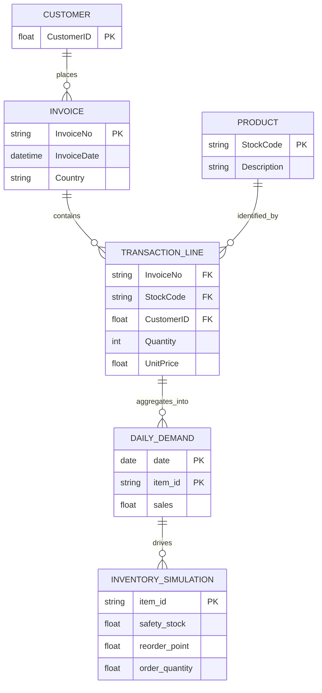

# Dataset Specifications & Entity Models

## 1. Selected Dataset Profile: UCI Online Retail
- **Official Repository**: [UCI Machine Learning Repository: Online Retail Dataset](https://archive.ics.uci.edu/dataset/352/online+retail)
- **Domain**: E-commerce / wholesale transactions for a UK-based registered non-store online retail business.
- **Timeframe**: 01/12/2010 to 09/12/2011 (approx. 541,909 raw records).
- **Format**: Distributed officially as an Excel workbook (`Online Retail.xlsx`). Can also be processed as CSV.
- **Granularity**: Line-item transaction level, to be aggregated to daily product-level demand.

---

## 2. Entity Relational Mapping

---

## 3. Canonical Field Specifications

| Field Name | Storage Type | Nullable | Domain / Constraints | Operational Semantics |
| :--- | :--- | :--- | :--- | :--- |
| `InvoiceNo` | String | No | 6-digit number or 'C'+number | Unique invoice identifier. Prefix 'C' flags a cancellation. |
| `StockCode` | String | No | 5-digit number or code | Unique product (item) identifier (e.g. `85123A`). |
| `Description` | String | Yes | Free text | Product description name. |
| `Quantity` | Integer | No | $[-80995, 80995]$ | Units per transaction line. Negative values indicate returns. |
| `InvoiceDate` | Datetime | No | Contiguous timestamps | Timestamp of invoice issuance. |
| `UnitPrice` | Float | No | $\ge 0.0$ | Price per unit in GBP (£). |
| `CustomerID` | Float | Yes | 5-digit identifier | Unique customer ID. Null for unregistered wholesale checkouts. |
| `Country` | String | No | Text (e.g., `United Kingdom`) | Customer country of residence. |
