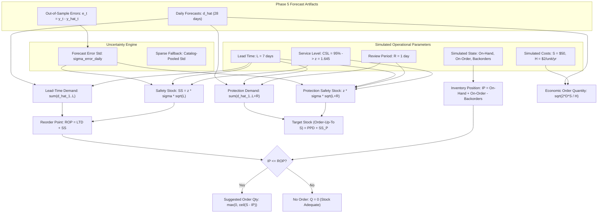

# Phase 6: Inventory Optimization & Replenishment Policy

## 1. Operational Boundary & Simulation Disclaimer

> [!IMPORTANT]
> **Data-Source Boundary & Simulation Notice:**
> The underlying transactional dataset (UCI Online Retail) records historical sales invoices between December 2010 and December 2011. It does **not** provide verified historical operational records for:
> - Physical on-hand warehouse inventory.
> - Outstanding purchase orders or supplier lead times.
> - Unfulfilled customer backorders or stockouts.
> - Purchase order processing costs or inventory carrying/holding costs.
> 
> Consequently, **all stock levels, lead times, cost parameters, and review frequencies are strictly SIMULATED operational parameters**. This project demonstrates operations research and supply chain decision-making logic driven by real time-series demand forecasts, but it **does not claim observed stock levels, historical stockout reductions, or realized dollar savings**.

---

## 2. Inventory Control Framework

The inventory engine implements a **Periodic-Review Order-Up-To $(R, s, S)$ policy**, bridging Phase 5 predictive daily demand forecasts with prescriptive replenishment actions.

---

## 3. Mathematical Formulations

### A. Net Inventory Position ($IP$)
Inventory position measures the total effective stock committed and available to cover demand:
$$IP = \text{On-Hand Stock} + \text{On-Order Stock} - \text{Backorders}$$
- **On-Hand Stock ($\ge 0$):** Physical inventory currently on warehouse shelves.
- **On-Order Stock ($\ge 0$):** Replenishment orders already placed with suppliers and in transit.
- **Backorders ($\ge 0$):** Unfulfilled customer demand committed during prior stockout periods.

### B. Forecast Error Uncertainty Estimation ($\sigma_{\text{error, daily}}$)
Uncertainty is derived exclusively from **genuine out-of-sample forecast errors** generated during Phase 5 rolling evaluation ($N = 68,907$ observations across 28 test days):
$$e_{i,t} = y_{i,t} - \hat{y}_{i,t}$$
For products with sufficient test history ($N_i \ge 7$ days), the daily error standard deviation is calculated using sample standard deviation:
$$\sigma_{i} = \sqrt{\frac{1}{N_i - 1} \sum_{t=1}^{N_i} (e_{i,t} - \bar{e}_i)^2}$$
- **Sparse-History Fallback:** For products with $< 7$ out-of-sample days (or single observations where sample variance is undefined), the engine applies the **catalog-wide pooled forecast error standard deviation** ($\sigma_{\text{catalog}} = 34.78$) and explicitly flags `is_uncertainty_fallback = True`.

### C. Safety Stock ($SS$)
Safety stock buffers against daily forecast errors across replenishment lead time:
$$SS = z \times \sigma_{\text{error, daily}} \times \sqrt{L}$$
Where:
- $z = \Phi^{-1}(\text{service\_level})$ is computed via `scipy.stats.norm.ppf(service_level)` (e.g. $z = 1.6449$ for $95\%$ Cycle Service Level).
- $L$ is the supplier replenishment lead time in days (simulated default: 7 days).

### D. Expected Lead-Time Demand ($LTD$)
Sum of daily demand forecasts across the upcoming lead-time horizon:
$$LTD = \sum_{t=1}^{L} \hat{d}_t$$
The pipeline verifies that the forecast horizon spans at least $L$ days and all daily forecast values are finite and non-negative.

### E. Dynamic Reorder Point ($ROP$)
The inventory threshold triggering replenishment:
$$ROP = LTD + SS$$
When $IP \le ROP$, a replenishment order is triggered.

### F. Target Stock (Order-Up-To Level $S$) & Protection Period ($P$)
In a periodic review system with review period $R$ and lead time $L$, newly ordered inventory arrives after $L$ days and must protect against stockouts until the *subsequent* review order arrives $R$ days later. The total protection period is:
$$P = L + R$$
- **Expected Protection-Period Demand ($PPD$):**
  $$PPD = \sum_{t=1}^{L + R} \hat{d}_t$$
- **Safety Stock for Protection Period ($SS_P$):**
  $$SS_P = z \times \sigma_{\text{error, daily}} \times \sqrt{L + R}$$
- **Target Stock ($S$):**
  $$S = PPD + SS_P$$

> [!CAUTION]
> **No Double-Counting:** Lead-time demand ($LTD$) is a strict mathematical subset of protection-period demand ($PPD$). They are **not** added together ($S = PPD + SS_P$, not $LTD + PPD + SS$).

### G. Suggested Replenishment Order Quantity ($Q$)
If an order is triggered ($IP \le ROP$):
$$Q = \max\left(0, \lceil S - IP \rceil\right)$$
Whole-unit ceiling rounding (`math.ceil`) is applied to guarantee that fractional ordering does not erode the safety stock buffer. If $IP > ROP$, $Q = 0$.

### H. Economic Order Quantity ($EOQ$) Benchmark
As an operational cost trade-off benchmark, classical Wilson EOQ is computed:
$$EOQ = \sqrt{\frac{2 \cdot D \cdot S}{H}}$$
- $D$: Annualized demand ($\bar{d}_{\text{daily}} \times 365$).
- $S$: Simulated setup cost per purchase order (\$50.00).
- $H$: Simulated holding cost per unit per year (\$2.00).
- If $D = 0$, $EOQ = 0.0$.

---

## 4. End-to-End Verifiable Hand-Calculation Example

| Step | Parameter / Formula | Numerical Input | Result |
| :--- | :--- | :--- | :--- |
| **1. Forecast Demand** | Daily forecast $\hat{d}_t$ for 10 days | $10.0\text{ units/day}$ | $\bar{d} = 10.0$ |
| **2. Uncertainty** | Out-of-sample error std $\sigma_{\text{error}}$ | $\sigma_d = 2.0\text{ units/day}$ | $\sigma_d = 2.0$ |
| **3. Service Level** | Cycle Service Level $CSL = 95\%$ | $z = \Phi^{-1}(0.95)$ | $z \approx 1.6449$ |
| **4. Lead Time** | Supplier lead time $L$ | $7\text{ days}$ | $L = 7$ |
| **5. Review Period** | Periodic review frequency $R$ | $1\text{ day}$ | $P = L + R = 8\text{ days}$ |
| **6. Lead-Time Demand** | $LTD = \sum_{t=1}^7 \hat{d}_t$ | $7 \times 10.0$ | **$70.0\text{ units}$** |
| **7. Safety Stock ($SS$)** | $SS = 1.6449 \times 2.0 \times \sqrt{7}$ | $1.6449 \times 2.0 \times 2.6458$ | **$8.7037\text{ units}$** |
| **8. Reorder Point ($ROP$)** | $ROP = LTD + SS$ | $70.0 + 8.7037$ | **$78.7037\text{ units}$** |
| **9. Protection Demand** | $PPD = \sum_{t=1}^8 \hat{d}_t$ | $8 \times 10.0$ | **$80.0\text{ units}$** |
| **10. Protection $SS_P$** | $SS_P = 1.6449 \times 2.0 \times \sqrt{8}$ | $1.6449 \times 2.0 \times 2.8284$ | **$9.3047\text{ units}$** |
| **11. Target Stock ($S$)** | $S = PPD + SS_P$ | $80.0 + 9.3047$ | **$89.3047\text{ units}$** |
| **12. Simulated State** | On-Hand = 50, On-Order = 10, Backorders = 0 | $IP = 50 + 10 - 0$ | **$IP = 60.0\text{ units}$** |
| **13. Order Trigger** | $IP \le ROP \implies 60.0 \le 78.7037$ | Condition holds | **TRIGGER REORDER** |
| **14. Order Quantity ($Q$)** | $Q = \lceil S - IP \rceil = \lceil 89.3047 - 60.0 \rceil$ | $\lceil 29.3047 \rceil$ | **$30\text{ units}$** |

---

## 5. Output Schemas & Artifacts

Execution of `scripts/generate_recommendations.py` produces:
1. `outputs/inventory/inventory_recommendations.parquet` (Full multi-product dataset)
2. `outputs/inventory/inventory_recommendations.csv` (CSV representation)
3. `outputs/inventory/replenishment_orders.csv` (Filtered active purchase orders)

### Key Output Columns:
- `product_id`: Product SKU identifier.
- `as_of_date`: Planning cutoff date as of which decisions are formulated (`2011-11-11`).
- `forecast_start_date`: First day of the forecast horizon (`2011-11-12`).
- `forecast_end_date`: Last day of the forecast horizon (`2011-12-09`).
- `is_retrospective_demonstration`: Boolean (`True`) explicitly denoting a historical evaluation backtest.
- `recommendation_type`: Categorical label (`RETROSPECTIVE_DEMONSTRATION`).
- `forecast_model`: Model supplying demand projections (`random_forest_pred`).
- `forecast_horizon_days`: Available out-of-sample forecast days ($28$).
- `expected_daily_demand`: Daily mean forecast.
- `expected_lead_time_demand`: Cumulative demand across lead time $L$.
- `expected_protection_period_demand`: Cumulative demand across protection period $L + R$.
- `forecast_error_std`: Daily out-of-sample forecast error standard deviation.
- `error_history_count`: Sample size of out-of-sample error observations.
- `is_uncertainty_fallback`: Flag indicating if catalog pooled fallback was used.
- `service_level`: Configured service level (0.95).
- `z_score`: Standard normal quantile (1.6449).
- `lead_time_days`: Replenishment lead time (7).
- `review_period_days`: Review frequency (1).
- `protection_period_days`: Protection horizon (8).
- `safety_stock`: Buffer units for lead time.
- `reorder_point`: Threshold triggering replenishment.
- `simulated_on_hand`: Simulated warehouse inventory.
- `simulated_on_order`: Simulated transit inventory.
- `simulated_backorders`: Simulated backordered demand.
- `inventory_position`: Net inventory position ($IP$).
- `target_stock`: Periodic review order-up-to level ($S$).
- `suggested_order_qty`: Recommended order batch size ($Q$).
- `reorder_triggered`: Boolean indicator ($IP \le ROP$).
- `economic_order_quantity`: Wilson EOQ batch size.
- `recommendation_status`: Status label (`REORDER_NOW`, `STOCK_ADEQUATE`, `UNAVAILABLE_INSUFFICIENT_HORIZON`, `UNAVAILABLE_MISSING_UNCERTAINTY`).
- `is_simulated_operational_input`: Explicit indicator (`True`) designating operational inputs as modeled simulations.

---

## 6. Key Assumptions & Limitations

1. **Independent Forecast Errors:** The safety stock formula assumes daily forecast errors are approximately independent and normally distributed. For retail products exhibiting strong autocorrelation or non-normal error spikes, actual stockout probabilities may differ from theoretical $1 - CSL$.
2. **Fixed Lead Times:** Lead times are modeled as deterministic ($L = 7\text{ days}$, $\sigma_L = 0$). Supplier delivery delays in real-world retail expand stockout risk.
3. **Intermittent / Sparse Demand:** For slow-moving items with long streaks of zero demand, standard deviation of errors and normal safety stock formulations can over-estimate required buffer stock. Sizing for intermittent demand typically benefits from discrete compound Poisson or bootstrapping methods.
4. **Simulated State Independence:** Simulated on-hand stock levels are generated to demonstrate decision logic across diverse stock conditions ($0.4 \times ROP$ to $1.4 \times ROP$) and do not track actual historical warehouse trajectories.
