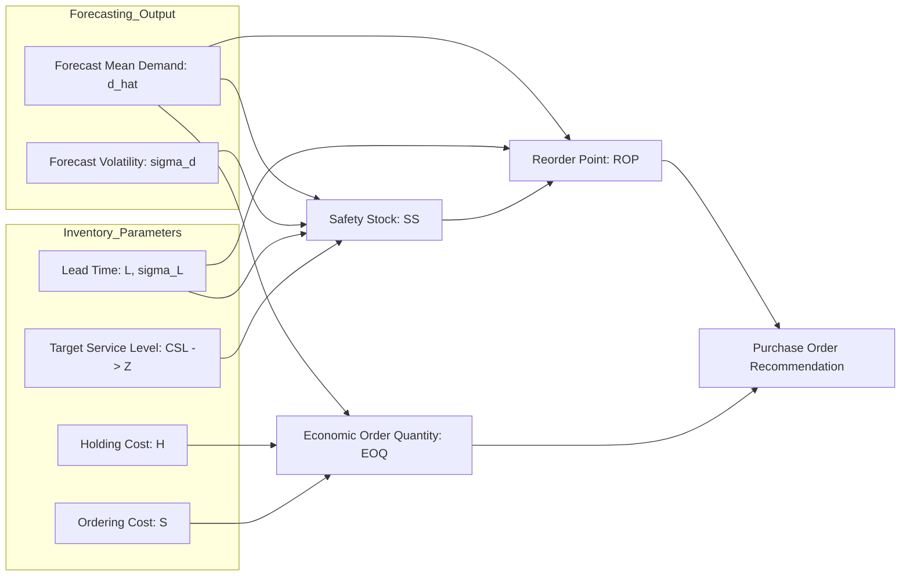

# Inventory Optimization & Operations Research Logic

> [!IMPORTANT]
> **Data-Source Boundary & Simulation Notice:**
> The UCI Online Retail dataset contains transaction invoices only. Physical on-hand inventory,
> outstanding purchase orders, supplier lead times, and operational costs are SIMULATED parameters.
> See [docs/05_inventory_optimization.md](file:///d:/Anushka/IIT/DS/Retail%20Sales%20Forecasting%20&%20Inventory%20Optimization%20System/docs/05_inventory_optimization.md) for full implementation details.

## 1. Mathematical Formulation

The inventory optimization module translates forecasted demand ($\hat{d}$) and uncertainty ($\sigma_d$) into concrete operational decisions: when to order and how much to order.

---

## 2. Core Operational Metrics & Formulas

### 1. Safety Stock ($SS$)
Under demand and lead time uncertainty:
$$SS = Z \times \sqrt{L \cdot \sigma_d^2 + \bar{d}^2 \cdot \sigma_L^2}$$
Where:
- $Z$: Standard normal score corresponding to the Target Cycle Service Level ($CSL$), e.g., $Z=1.65$ for 95%, $Z=2.33$ for 99%.
- $L$: Mean supplier lead time in days.
- $\sigma_d$: Standard deviation of daily demand forecast error.
- $\sigma_L$: Standard deviation of lead time variability.

### 2. Dynamic Reorder Point ($ROP$)
$$ROP = (\bar{d} \times L) + SS$$
- When current stock position (on-hand + on-order - backorders) $\le ROP$, a replenishment order is triggered.

### 3. Economic Order Quantity ($EOQ$)
Balances ordering setup costs against inventory holding costs:
$$EOQ = \sqrt{\frac{2 \cdot D \cdot S}{H}}$$
Where:
- $D$: Annualized or horizon demand.
- $S$: Fixed cost per order transaction.
- $H$: Annual holding cost per unit ($H = h \times \text{unit\_cost}$).

---

## 3. Inventory Simulation & Backtesting
To validate the policy, a discrete-event or daily step inventory simulator evaluates:
- **Service Level Achieved (Fill Rate)**: $\frac{\text{Total Units Sold}}{\text{Total Demand}}$.
- **Stockout Rate**: % of periods where demand $> 0$ but inventory was depleted.
- **Total Operational Cost**: $\text{Holding Costs} + \text{Ordering Costs} + \text{Stockout Penalty Costs}$.
