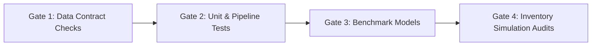

# Verification & Validation Framework

## 1. Quality Gates & Validation Strategy

To ensure strict correctness of implementations across data processing, modeling, and inventory optimization, the system applies explicit verification gates.

---

## 2. Gate Specifications

### Gate 1: Data Contract & Leakage Checks
- Assert continuous calendar series per store/SKU.
- Assert zero target leakage (features at time $t$ use only information known strictly before $t$).
- Schema validation against strict null thresholds and negative value invariants.

### Gate 2: Unit Testing Suite
- Test coverage for:
  - Feature transformation logic (lags, rolling statistics).
  - Outlier handling and edge cases (e.g. stores closed during holidays).
  - Safety stock and ROP calculations against analytical benchmark values.

### Gate 3: Forecasting Performance Benchmarks
- Model must beat naive and seasonal naive baselines by at least $15\%$ improvement on WAPE and RMSE.
- Calibration check on prediction intervals (e.g., empirical coverage of 90% prediction intervals should fall between 88%–92%).

### Gate 4: Inventory Policy Validation
- Run historical re-simulation over the test horizon comparing:
  - Baseline static replenishment vs. Model-driven dynamic ROP/EOQ.
  - Metrics: Holding cost reduction, Stockout occurrences, and Fill Rate compliance.
