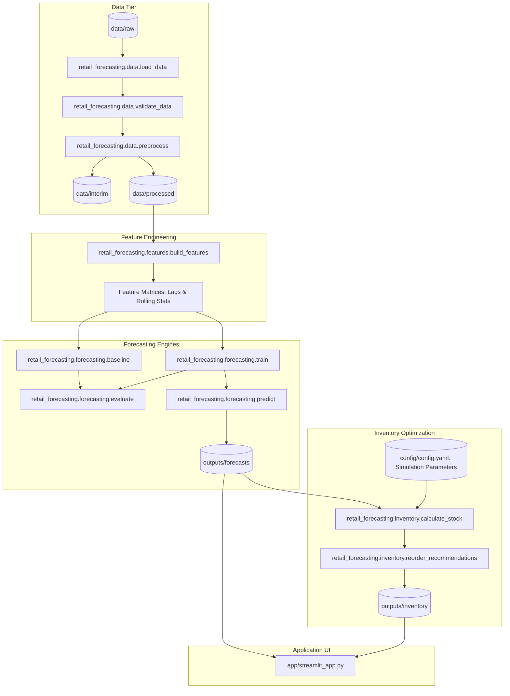

# Project Architecture & Modular Design

> **Overview**: Detailed blueprint of the system architecture, component contracts, and technical boundaries.

---

## 1. System Topology

The architecture separates data ingestion, feature generation, predictive demand modeling, and inventory optimization into distinct, decoupled Python submodules.

---

## 2. Module Responsibilities & Interfaces

| Module Path | Primary Responsibility | Key Inputs / Outputs |
| :--- | :--- | :--- |
| `src/retail_forecasting/data/` | Ingestion, validation, cleaning, and daily aggregation | Raw files $\rightarrow$ Clean daily series |
| `src/retail_forecasting/features/` | Feature engineering (lags, rolling stats, calendar features) | Daily series $\rightarrow$ Feature matrix |
| `src/retail_forecasting/forecasting/` | Seasonal Naive baseline, Random Forest training, metrics | Feature matrix $\rightarrow$ Trained models & Forecasts |
| `src/retail_forecasting/inventory/` | Safety stock, ROP, EOQ, replenishment suggestions | Forecasts + Sim params $\rightarrow$ Orders |
| `src/retail_forecasting/visualization/`| Standardized Matplotlib charts | Time series data $\rightarrow$ Figure objects |
| `app/` | Interactive Streamlit user dashboard | Forecasts & Inventory $\rightarrow$ Browser UI |

---

## 3. Configuration Management
- System configurations reside in [`config/config.yaml`](file:///d:/Anushka/IIT/DS/Retail%20Sales%20Forecasting%20&%20Inventory%20Optimization%20System/config/config.yaml).
- No hardcoded paths, random seeds, or business parameters are permitted within the core library.
